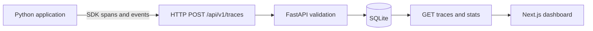

# AgentTrace architecture and reproducible demo

AgentTrace is a **self-hosted observability MVP** for instrumented Python
applications. It collects application-provided telemetry; it does **not**
capture hidden chain-of-thought or automatically instrument external LLMs.

## Data flow



### Component responsibilities

| Component | Responsibility |
| --- | --- |
| `agenttrace/sdk.py` | Decorator, span context, error capture and optional HTTP export |
| `agenttrace/models.py` | Trace, span and event representation |
| `agenttrace/api.py` | HTTP ingestion, queries and optional bearer key |
| `agenttrace/storage.py` | SQLite persistence and aggregate statistics |
| `web/pages/index.tsx` | Browser dashboard, filtering, refresh and trace inspection |

**Data boundaries:** The application decides which event messages and attributes
are logged. Do not log credentials, personal data or sensitive prompts. The
example below uses fixed, non-sensitive strings.

## Five-minute local demo

Start the API and dashboard with Docker Compose from the repository root:

```bash
docker compose up --build
```

In another terminal, install the Python SDK and run the demonstration:

```bash
python -m pip install -e .
python -m agenttrace.examples.monitoring_demo --export --runs 3
```

Open `http://localhost:3000` and click **Refresh data**. You should see
`Document Research Agent` executions with nested `retrieve_documents`,
`rank_results` and `prepare_summary` spans. The third run intentionally
raises an exception to show how failures are represented.

To generate telemetry **without sending it anywhere**:

```bash
python -m agenttrace.examples.monitoring_demo --runs 3
```

To point the SDK to another ingestion endpoint:

```bash
python -m agenttrace.examples.monitoring_demo --export \
  --endpoint http://localhost:8000/api/v1/traces
```

If the API is configured with `AGENTTRACE_API_KEY`, set the same key in the
SDK environment. **Do not commit secrets.** Note that the browser dashboard
does not provide an authenticated proxy, so a protected API needs an
appropriate server-side access layer for browser access.

### What is real vs. simulated?

- **Real:** Python SDK instrumentation, span nesting, event and metric capture,
  error propagation, HTTP ingestion, SQLite storage and dashboard queries.
- **Simulated:** The demo's document retrieval, ranking and failure condition.
  It uses a deterministic local fixture; no model inference, paid API, external
  search engine or provider-specific integration is involved.

## Quality checks

```bash
ruff check .
pytest -q --cov=agenttrace --cov-report=term-missing
cd web
npm install
npm test
npm run typecheck
npm run build
```

The repository CI also builds the API and dashboard Docker images.

## Design trade-offs and next steps

- **SQLite** is simple for local evaluation; concurrent production workloads
  may need a server database, retention policies and migrations.
- **HTTP export** is easy to integrate but is not a durable delivery queue.
  The SDK intentionally does not crash applications when export fails.
- **Optional API key** is a starting point, not full user authentication or
  authorization. Protect the deployment before exposing real telemetry.
- **Manual refresh** is not streaming or real-time push monitoring.
- Future improvements: OpenTelemetry adapters, role-based access, server-side
  authenticated dashboard, rate limiting and deployment configuration.

For the full repository overview, see [README](../README.md).
